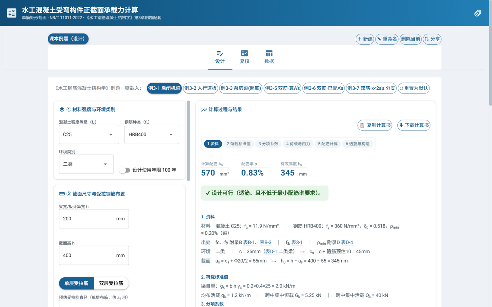
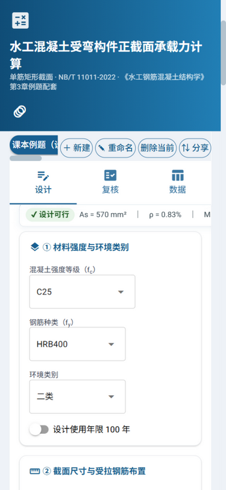
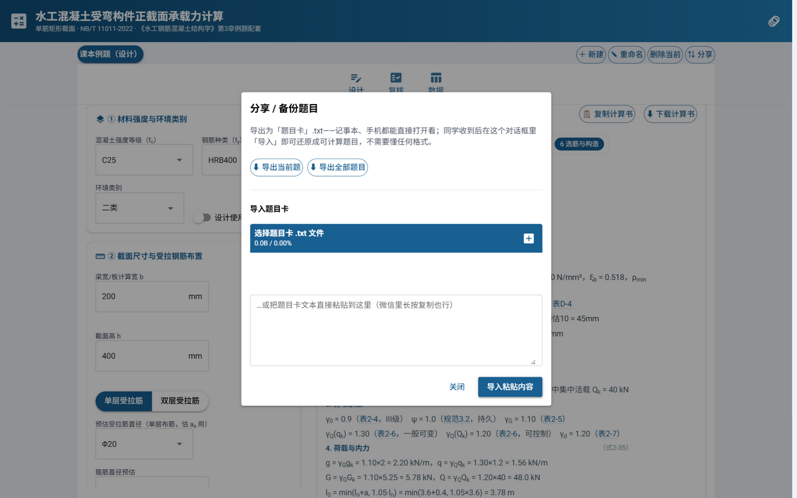

# 水工混凝土受弯构件正截面承载力计算（NB/T 11011-2022）

单筋矩形截面受弯构件的**截面设计**（荷载 → 内力 → M → As）与**承载力复核**
（As → Mu → 安全判定）交互计算工具。计算过程按《水工钢筋混凝土结构学》
第 3 章例题的解题骨架排版（编号小节、查表出处、判定成句、中间量按手算
习惯舍入代入），可一键载入教材例题对照。

| 桌面（宽屏双栏，输入左 / 结果右） | 窄屏（单栏 + 实时摘要条常驻） |
| --- | --- |
|  |  |

题目可导出为**可直接阅读的 .txt 题目卡**发微信/网盘，对方一键导入还原（不需要懂任何格式）：



## 功能亮点

- **题型模板**：「＋新建」弹出菜单——设计题 / 复核题（空白模板，自动切对应页签）
  或复制当前；题目按类型标记，题号条显示"（设计）/（复核）"，支持多题切换；
  **题目不跨会话保留**（每次启动重置为出厂题库，仅课本例题）
- **题目卡分享/备份**：顶栏「⇅ 分享」把题目导出为可直接阅读的 .txt 文本（记事本/手机可开、微信直发），
  对方在同一对话框「导入」即可还原成可计算题目；也支持粘贴文本导入、整库一键备份
- **教材式计算过程**：1 资料 → 2 荷载标准值（自重按 b·h·γc 推导）→ 3 分项系数
  （逐条带表号出处）→ 4 荷载与内力 → 5 配筋计算（判定为教材整句）→ 6 选筋与构造
- **超筋/少筋续演**：反解可行截面高后自动重算一遍（教材例 3-3 写法），
  一键"改 h 重算"；复核不安全时反解最小截面高
- **选筋建议**：按附录 C 推荐实配，含排布宽度验算、双层布置、内联实配回验、
  一键"去复核"联动
- **计算书**：分节纯文本，一键复制或下载为 .txt
- **配筋图**：教材式截面图（梁箍筋内缩 c、双层形心=cs+35；板平面网格+纵剖面），
  点击选筋表实时切换
- **数据可溯源**：全部查表数值来自 `kernel/data/*.json`，每条带 source 字段，
  界面"数据"页签可查

## 目录结构

```
main.py                                  交互界面（NiceGUI）
problems_io.py                           题目卡导入导出（.txt 文本交换格式）
kernel/                                  计算内核（纯 Python，无界面依赖）
  singly_rect.py                         设计/复核核心（式3-12~3-19，手算舍入链）
  pipeline.py                            编排层：编号小节/计算书/续演/反解
  loading.py                             荷载→内力→弯矩链条（式2-35）
  section.py                             cs、as、h0（式3-20）
  rebar.py                               选筋建议（附录C 表C-1/C-2 算法）
  drawing.py                             教材式 SVG 配筋图
  textmath.py                            HTML 分式/根号与纯文本排版
  spec_data.py                           规范数据访问层
  data/spec_NB_T_11011-2022.json         数字化的规范数据（带 source 溯源）
tests/                                   内核回归（教材例题锚点 + 绘图几何 + 编排层 + 题目卡格式）
build_exe.bat                            Windows 一键打包（纯 ASCII 壳，逻辑在 build_exe.py）
build_exe.py                             打包逻辑（PyInstaller，配置见 受弯承载力计算.spec）
assets/                                  README 截图
problems.json                            题目库（运行时自动生成/保存，不入库，随 exe 分发携带）
requirements.txt                         依赖版本（NiceGUI/pywebview/PyInstaller）
```

## 运行（开发模式）

```bash
pip install -r requirements.txt              # 仅首次
python main.py                              # 浏览器模式 http://localhost:8380
python main.py --native                     # 桌面窗口模式
```

首次运行会自动生成题库文件 `problems.json`（运行时数据，会话内每次计算自动保存）。
**每次启动程序都会重置为出厂题库（顶部只保留"课本例题"）**：会话里新建、导入的题目
不跨会话保留；要带走题目，用「⇅ 分享」导出题目卡，下次导入即可。

## 打包分发（exe）

```bash
build_exe.bat        # 或手动：见脚本内命令
```

产物 `dist\受弯承载力计算.exe`，发给同学双击即用，无需安装 Python。

## 数据来源说明

所有可选项（混凝土等级、钢筋种类、环境类别、钢筋直径、最小配筋率等）
由 `kernel/data/spec_NB_T_11011-2022.json` 驱动，界面下拉框自动跟随。
表值为规范/教材附录中的数值事实，逐条标注出处（表号）；规范原文请以
正式出版文本为准。扩充数据时保持 `{value/source}` 结构即可，计算代码不用改。

## 免责声明

本工具面向**教学与教材例题对照**场景：计算过程、舍入习惯与判定语句均按
《水工钢筋混凝土结构学》第 3 章手算口径实现，并与教材例题逐字对照。它不
替代正式设计软件与规范要求——实际工程使用时，请按现行规范自行校核并承担
相应的设计责任。

## License

[MIT](LICENSE)

## 校验

```bash
python tests/test_examples.py     # 五道教材例题逐项对照（例3-1~3-4、例3-8）
python -m pytest tests/ -q        # 全部锚点测试（需 pip install pytest）
```

推送后由 GitHub Actions 自动运行同样的测试（见 `.github/workflows/ci.yml`）。
